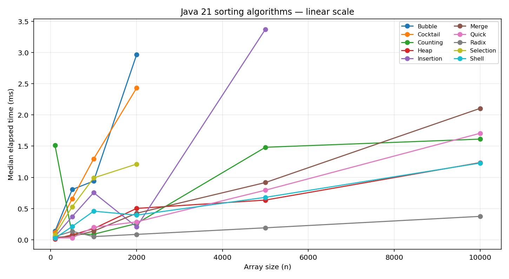
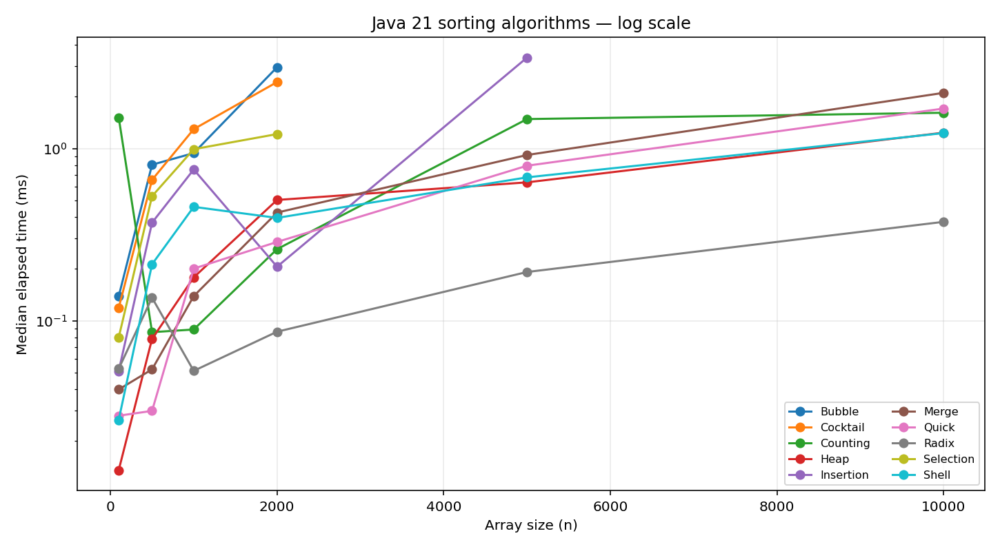

# Java Data Structures & Sorting Lab

**A hands-on Java 21 learning repository.** Implement sorting algorithms, searches and simplified Java-like collections **from scratch**, explore complexity and test behavior against the Java standard library.

> The code is intentionally educational, not a drop-in replacement for production JDK collections.

## What you will learn

- Implement ten sorting algorithms, **each in its own package** under `src/main/java`.
- Build your own interfaces `MyCollection`, `MyList`, `MySet`, `MyMap` and eight collections.
- Understand dynamic arrays, nodes, hash collisions, resizes, ring buffers and binary trees.
- Compare algorithms using deterministic data, tests and measured benchmark charts.

## Sorting performance — measured, not theoretical

The following charts come from Java 21 executions on the environment described in [`benchmarks/environment.md`](benchmarks/environment.md).





> Median of 7 runs after 4 warmups, random integers, measured sort only. Quadratic sorts skip larger input sizes. This is a lightweight educational benchmark, **not JMH**; results change with CPU, JIT, GC and workload. See the [methodology](docs/methodology.md) and [raw CSV](benchmarks/results.csv).

## Sorting algorithms

| Package | Algorithm | Expected average | Properties |
|---|---|---|---|
| `sorting.bubble` | Bubble Sort | O(n²) | stable, early exit |
| `sorting.selection` | Selection Sort | O(n²) | in-place |
| `sorting.insertion` | Insertion Sort | O(n²) | stable, good for almost sorted |
| `sorting.cocktail` | Cocktail Sort | O(n²) | bidirectional bubble |
| `sorting.shell` | Shell Sort | gap-dependent | halving sequence |
| `sorting.merge` | Merge Sort | O(n log n) | stable, extra buffer |
| `sorting.quick` | Quick Sort | O(n log n) | median-of-three pivot |
| `sorting.heap` | Heap Sort | O(n log n) | in-place, deterministic bound |
| `sorting.counting` | Counting Sort | O(n+k) | bounded integer keys, safe range limit |
| `sorting.radix` | Radix Sort | O(4n) | signed int, four byte passes |

Complexity and stability detail: [`docs/complexity.md`](docs/complexity.md).

## Our own Java-style collections

| Package | Implementation | Learning focus |
|---|---|---|
| `collections.arraylist` | `MyArrayList<E>` | resizing, index shifting, iteration |
| `collections.linkedlist` | `MyLinkedList<E>` | doubly linked nodes |
| `collections.hashset` | `MyHashSet<E>` | hashing, collisions, no duplicates |
| `collections.hashmap` | `MyHashMap<K,V>` | buckets, update, null keys |
| `collections.arraydeque` | `MyArrayDeque<E>` | circular array and growth |
| `collections.stack` | `MyStack<E>` | LIFO |
| `collections.queue` | `MyQueue<E>` | FIFO |
| `collections.binarysearchtree` | `MyBinarySearchTree<E>` | ordering and in-order traversal |

Two search algorithms: `searching.linear.LinearSearch` and `searching.binary.BinarySearch`.

## Requirements and quick start

- JDK **21** (`java -version`)
- Maven 3.9+ for JUnit tests and workflow (optional for Java-only examples)
- Python 3 + Matplotlib **only to regenerate charts**

```bash
git clone https://github.com/YOUR_USERNAME/java-data-structures-lab.git
cd java-data-structures-lab
mvn clean verify
mvn -q exec:java -Dexec.mainClass=dev.learning.dsa.examples.SortingExamples
mvn -q exec:java -Dexec.mainClass=dev.learning.dsa.examples.CollectionExamples
```

No Maven? Compile and run the self-checks directly with Java 21:

```bash
mkdir -p target/classes
find src/main/java -name '*.java' > sources.txt
javac -d target/classes @sources.txt
java -cp target/classes dev.learning.dsa.verification.SmokeTests
java -cp target/classes dev.learning.dsa.examples.SortingExamples
```

## Example — sort and compare

```java
int[] numbers = {9, 3, -1, 9, 2};
new dev.learning.dsa.sorting.merge.MergeSort().sort(numbers);
// [-1, 2, 3, 9, 9]
```

```java
var myList = new dev.learning.dsa.collections.arraylist.MyArrayList<String>();
myList.add("Java");
myList.add("Algorithms");
System.out.println(myList.get(1)); // Algorithms
```

## Package layout

```text
src/
├── main/java/dev/learning/dsa/
│   ├── sorting/{bubble,selection,insertion,cocktail,shell,merge,quick,heap,counting,radix}/
│   ├── collections/{arraylist,linkedlist,hashset,hashmap,arraydeque,stack,queue,binarysearchtree}/
│   ├── searching/{linear,binary}/
│   ├── examples/
│   ├── benchmarks/
│   └── verification/
└── test/java/dev/learning/dsa/{sorting,collections,searching}/
```

## Learning path

1. Start with `BubbleSort` and trace comparisons manually.
2. Build `MyArrayList` and observe capacity growth.
3. Move to `MyLinkedList`, `MyStack` and `MyQueue`.
4. Study HashSet vs HashMap collision handling.
5. Compare Quick vs Merge vs Heap under different inputs.
6. Re-run benchmarks locally; explain why wall-clock timings differ from asymptotic complexity.
7. Extend the lab: TreeSet, balanced BST, PriorityQueue, graph traversal, JMH benchmark module.

## Tests and benchmarks

`mvn verify` executes JUnit 5 correctness tests (including empty arrays, duplicates, signed extremes and randomized comparisons with `Arrays.sort`). The dependency-free `SmokeTests` also verifies core behavior.

```bash
java -cp target/classes dev.learning.dsa.benchmarks.SortingBenchmarks > benchmarks/results.csv
python3 -m pip install matplotlib
python3 scripts/plot_benchmarks.py benchmarks/results.csv docs/assets
```

[Benchmark methodology](docs/methodology.md) · [Complexity reference](docs/complexity.md) · [License](LICENSE)

## Security and privacy

There are **no API keys, passwords, private data, or external network calls** in the application code. Credentials and generated build outputs are ignored in `.gitignore`. The project uses only deterministic sample data.

## License

MIT.
